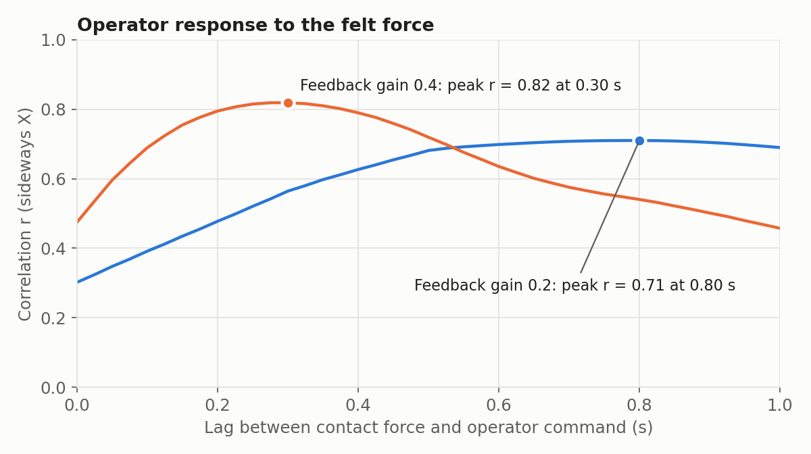
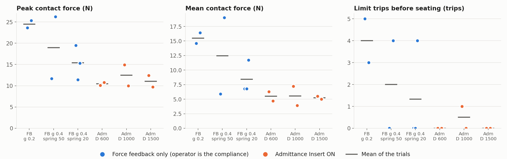
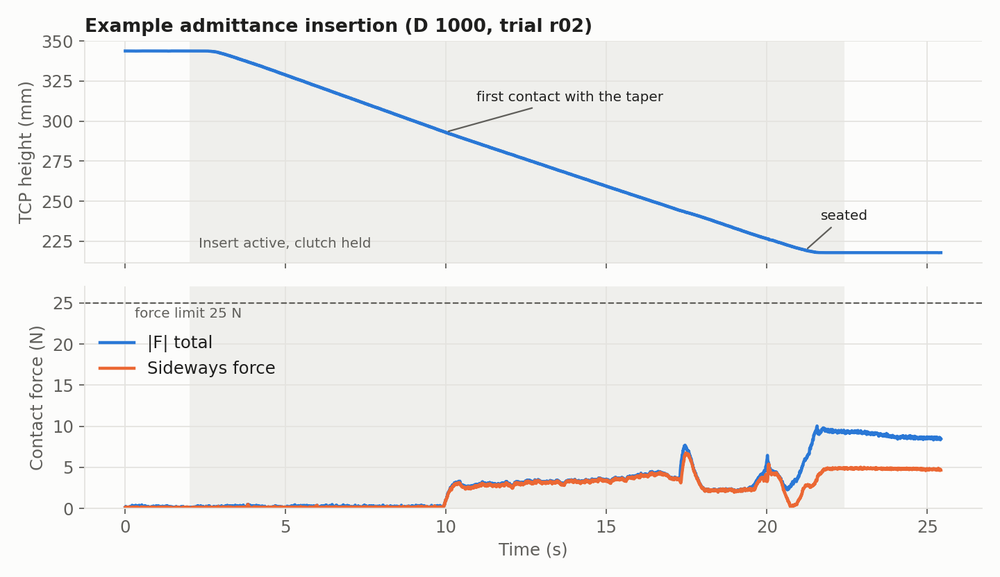

# Tuning the admittance Insert on the real UR3e

Session of 24 November 2026: 13 recorded peg-in-hole trials on the real robot (plus a sensor-noise
recording and one void trial), going from "the operator is the compliance" to a tested admittance setting.

**Result:** the admittance Insert now uses **D = 1000 Ns/m, M = 40 kg, K = 400 N/m sideways**
(Z unchanged: D 1000 Ns/m, M 60 kg, K 0). With the Insert on, all six admittance insertions seated
fully. Peak contact force was about 11 N on average, against about 15 N for the best force-feedback-only
trials. Only one limit trip came before seating, against 4 in the force-feedback-only trials.

## Suggested slide outline

| # | Slide | Section | Figure / table |
|---|---|---|---|
| 1 | The task: peg-in-hole for blanket handling | [Setup](#1-setup) | photo of the rig |
| 2 | How the teleoperation works | [Setup](#1-setup) | control-loop diagram (to draw) |
| 3 | Admittance control in one equation | [Admittance](#2-admittance-control) | equation + parameter table |
| 4 | Plan: learn M, D, K from the operator | [Method](#3-method) | 3-phase table |
| 5 | Measurement chain and safety | [Data](#4-data-collection-and-safety) | pipeline list |
| 6 | Phase 1: feedback gain matters | [Phase 1](#5-phase-1-the-operator-as-the-compliance) | `fig_operator_response.png` |
| 7 | The hidden 3 N: joystick spring | [Phase 1](#5-phase-1-the-operator-as-the-compliance) | before/after numbers |
| 8 | What the fit could and couldn't give | [Phase 2](#6-phase-2-fitting-m-d-k) | fit table |
| 9 | Phase 3: the admittance sweep | [Phase 3](#7-phase-3-admittance-sweep) | sweep table |
| 10 | Results: admittance vs. operator alone | [Results](#8-results) | `fig_outcomes.png` |
| 11 | What an insertion looks like | [Results](#8-results) | `fig_example_insertion.png` |
| 12 | Decision, limitations, next steps | [Decision](#9-decision) to [Next steps](#11-next-steps) | |

## 1. Setup

- **Robot:** Universal Robots UR3e with its built-in wrist force/torque sensor (usable range about
  30 N), driven over ROS 2 Jazzy (Ubuntu 24.04) with the UR ROS 2 driver.
- **Master:** Novint Falcon, a 3-DoF haptic device that can push back with up to about 9 N
  (capped at 7 N here).
- **Task:** insert a gripper housing (the "peg", 733 g, held by the tool) into a tapered socket.
  This is a mock-up of breeding-blanket handling in tokamak remote maintenance. The pendant TCP
  is at the peg tip.
- **Teleoperation mode: "twist" (joystick).** The Falcon grip works like a joystick: how far it is
  pushed from centre sets the tool's speed. Holding a grip button is the clutch (dead-man).
  A spring pulls the grip back to centre. The velocity is sent at 100 Hz to the UR twist
  controller; force feedback runs at 200 Hz.
- **Force feedback:** the contact force from the wrist sensor, scaled by `ft_gain`, is pushed back
  into the operator's hand through the Falcon.

## 2. Admittance control

Tapping the Falcon's minus button toggles the **admittance Insert**. The robot then behaves like a
virtual mass-damper-spring, separately per axis, driven by the measured contact force:

```
M·a + D·v + K·x = F_contact
```

- **D (damping):** how fast the tool yields to a steady force. Steady speed = F / D, so 1000 Ns/m
  gives 1 mm/s per newton.
- **K (stiffness):** pulls the tool back towards where the Insert started; steady offset = F / K.
- **M (virtual mass):** sets the response time M / D. It is kept short (40 ms) so the robot reacts
  quickly to contact.
- Z (insertion direction) has no spring (K = 0): the operator's push drives the insertion.
- Force deadband 1 N, speed cap 50 mm/s. Integrated with RK4 every control cycle.

When the taper pushes the peg sideways, the sideways admittance lets it slide into line with the
socket. Choosing D, M and K is the question this session answers.

## 3. Method

The idea was to learn the parameters from a human. With the admittance off and only force
feedback on, the operator has to provide the compliance by hand. Fitting M, D, K to how the
operator's commands respond to the contact force should then give parameters that "insert like
a person".

| Phase | Admittance | What changes | Trials |
|---|---|---|---|
| 1. Operator as compliance | off | feedback gain 0.2 → 0.4, centring spring 50 → 20 N/m | 7 |
| 2. Fit M, D, K | (offline) | equation-error then output-error fit | |
| 3. Sweep | **on** | D = 600 / 1000 / 1500 Ns/m, 2 trials each, mixed order | 6 |

The fit turned out not to be reliable on its own (section 6), so phase 3 tested the controller
directly, using the fit to choose the middle of the sweep.

## 4. Data collection and safety

**Per trial** (`record_trial.sh`):
- zeroes the wrist sensor with the peg free;
- saves the bridge parameters and trial metadata;
- records a ROS bag (TF, wrench, joint states, commanded twist) and the bridge's own CSV log.

**Analysis** (`analyze_trial.py`) resamples everything to 500 Hz, with:
- tool pose, velocity and acceleration (Savitzky–Golay);
- wrench in the sensor and base frames;
- commanded velocity and contact detection.

**Fitting** (`fit_admittance.py`) fits M, D, K and a delay per sideways axis, to the operator's
commanded motion.

**Sensor noise** (from a no-motion recording): about 0.05 N sideways, 0.1 N in Z, 0.01 Nm in torque.
It is negligible next to the contact forces.

**Contact limit (safety).** The robot stops if the contact force reaches 25 N (20 N in the first
trial) or the torque reaches 2 Nm. The limit latches, and releasing and re-pressing the clutch
clears it. If the contact is still over the limit at that point, only motion *away* from the
contact is allowed until the force drops (recovery mode). The sensor zero is taken once at the
start of each trial and kept for the whole trial.

**Data-collection preset:** slow motion (20 mm/s joystick, 50 mm/s cap) and no feedback deadband.

## 5. Phase 1: the operator as the compliance

### Feedback gain 0.2 was too weak

The operator's sideways commands followed the contact force only slowly: the strongest
correlation came at 0.8 s lag (r 0.71). Insertions were forceful, with peaks of 24–25 N and
3–5 limit trips before seating. The fits were degenerate: huge masses, with the delay stuck at
the edge of the search range.

### Gain 0.4: faster, stronger yielding



With the feedback doubled, the correlation peaks at **0.3 s** (r 0.82) instead of 0.8 s, and the
operator yields about **3× more per newton** (0.76 vs 0.23 mm/s per N). Going higher was rejected.
Scaled from the recorded forces, gain 0.6 would already reach the Falcon's 7 N cap, and gain 0.8
would sit on it 19 % of the time. Clipped feedback breaks the force-to-response relationship the
fit relies on, and more gain through a ~0.3 s loop delay risks oscillation.

### The hidden 3 N: the joystick centring spring

The operator reported feeling "a lot of force" in free air. The log showed the wrist sensor at
about 0 N while the Falcon pushed up with **1.5–3.6 N**: that was the centring spring
(50 N/m × up to 52 mm of grip travel). The slow preset made the operator hold the grip near full
deflection for the whole descent, and that force masked the real contact force.

Lowering `rate_spring` to **20 N/m** cut the free-air force to about **0.5 N** (max 1.5 N). A
relaxed-hand check confirmed the grip doesn't drift, so the robot doesn't creep.

## 6. Phase 2: fitting M, D, K

The fit treats operator + Falcon + robot as one admittance from the measured contact force to the
operator's commanded velocity. It uses the commanded rather than the measured motion, because in
contact the socket constrains the measured motion.

| Data | D in X (Ns/m) | D in Y (Ns/m) | Comment |
|---|---|---|---|
| gain 0.4, spring 50, r01 | 530 | 1640 | 2 contact segments |
| gain 0.4, spring 50, r02 | 870 | 1770 | rough trial, 26 N peak |
| gain 0.4, spring 20, r01 | 150 | 2470 | 1 segment, poor fit in Y (R² 0.42) |
| **gain 0.4, spring 20, r01–r03 together** | **970** | **910** | 9 segments, R² 0.99 / 1.00, K 630 / 440 N/m |

**What the fit gave:** the pooled spring-20 trials put sideways damping at about 950 Ns/m in both
axes, with stiffness at 440–630 N/m.

**What it couldn't give:**
- **M:** the virtual mass trades off against the operator's reaction delay, so the fit can't
  separate them. It returned 850–1650 kg, which is a 1–2 s response and far too sluggish.
  M is therefore set from a 40 ms response time (M = 0.04 × D).
- **Consistency:** single trials scatter by 3× or more. The operator sometimes yields reflexively
  to the force and sometimes steers deliberately, and that steering doesn't depend on the force.
  More of the same data would mostly measure that variation.

So the fit gives a centre point (D ≈ 1000, K ≈ 400) rather than a final answer, and the
controller itself was tested next.

## 7. Phase 3: admittance sweep

Settings, with Z unchanged in each (D 1000, M 60, K 0):

| Setting | D sideways | M sideways | K sideways |
|---|---|---|---|
| Low | 600 Ns/m | 24 kg | 400 N/m |
| **Centre (from the fit)** | **1000 Ns/m** | **40 kg** | **400 N/m** |
| High (previous default) | 1500 Ns/m | 60 kg | 400 N/m |

**Procedure for each trial:**
1. Zero the sensor with the peg free.
2. Drive to about 300 mm, just above the taper, centred by eye.
3. Tap minus to start the Insert, and hold the clutch while it guides the peg in.
4. Tap minus to end the Insert once the peg is seated.

Order: 1000 → 600 → 1500 → 600 → 1500 → 1000. After each trial the operator rated smoothness,
correction effort and compliance (multiple choice).

| Trial | First contact | Peak force | Mean contact force | Trips before seating | Smoothness | Correction | Compliance |
|---|---|---|---|---|---|---|---|
| D 600 r01 | 235 mm | 10.1 N | 6.3 N | 0 | very smooth | a little | about right |
| D 600 r02 | 297 mm | 10.8 N | 4.7 N | 0 | mostly smooth | a little | about right |
| D 1000 r01 | 298 mm | 14.9 N | 7.2 N | 1 (torque) | ("felt good") | | |
| **D 1000 r02** | 293 mm | **10.0 N** | **3.9 N** | 0 | very smooth | **none** | about right |
| D 1500 r01 | 300 mm | 12.4 N | 5.5 N | 0 | very smooth | a little | about right |
| D 1500 r02 | 287 mm | 9.7 N | 5.0 N | 0 | very smooth | a little | about right |

**Trip on seating:** every trial ended with a torque trip (2 Nm) at the moment the peg bottomed
out. That's the end stop, not a failure, so the table counts only trips before seating.

D 1000 r01 was the first admittance trial of the session. It was also left with the Insert still
on, which voided the following D 600 attempt; that trial is excluded and repeated.

## 8. Results



*FB = force feedback only (admittance off), g = feedback gain. Each dot is one trial; bars are means.*

| | Force feedback only (gain 0.4, spring 20; 3 trials) | Admittance Insert (all settings; 6 trials) |
|---|---|---|
| Peak contact force | 15.4 N (11.4–19.5) | **11.3 N** (9.7–14.9) |
| Mean contact force | 8.4 N | **5.4 N** |
| Limit trips before seating | 4 in total (all in one trial) | **1** in total |
| Fully seated | 2 of 3 | **6 of 6** |
| Operator correction | continuous steering | none to "a little" |



*D 1000 r02: the Insert lowers the peg at a steady rate. The taper is touched at about 293 mm, the
sideways force stays at 2–7 N while the admittance slides the peg into line, and it seats about
11 s later. The steady 9 N at the end is the peg resting on the bottom.*

**Main points:**
- **The admittance Insert is clearly better than the operator alone:** about 25 % lower peak force,
  35 % lower mean force, and almost no trips mid-insertion.
- **Between 600 and 1500 Ns/m the differences are small** and within the scatter of two trials per
  setting. The taper does most of the work, and any damping in this range lets it.
- The operator rated the compliance "about right" in every rated trial.

## 9. Decision

**Sideways D 1000 Ns/m, M 40 kg, K 400 N/m** (Z: D 1000, M 60, K 0) are now the defaults, in
`falcon_ur_teleop.py` and `admittance_insert.py`, which the MuJoCo simulation also uses. Reasons:

- it is the value the operator demonstrations pointed to (about 950 Ns/m pooled);
- it gave the best single trial (lowest mean force, no correction needed);
- it sits in the middle of a range that all worked, which leaves margin either way.

## 10. Limitations

- **One operator, two repeats per setting.** Enough to show that the admittance works and that the
  range is flat, not enough to rank 600 vs 1000 vs 1500 statistically.
- **Starting alignment varied:** first contact ranged from 235 to 300 mm, which moves force and time
  as much as the setting does.
- **M is chosen, not measured** (40 ms response time), because the fit can't separate it from the
  operator's delay.
- **One socket geometry and payload.**
- **The 2 Nm torque limit is reached when the peg bottoms out.** The peg is long, so a modest tip
  force gives a large wrist torque.

## 11. Next steps

1. More repeats and more operators at D 1000, plus a fixed set of start offsets (for example
   0 / 5 / 10 mm sideways), so alignment is controlled.
2. Avoid the trip on seating: end the Insert automatically when the peg stops descending, or raise
   the torque limit to about 2.5 Nm.
3. Tune Z (insertion speed vs. push force) the same way.
4. Re-run the sweep in the MuJoCo simulation with the same settings, to check it reproduces the
   flat response.

## Reproducing

```bash
# Data-collection preset, then the session's changes
ros2 param load /falcon_ur_teleop $(ros2 pkg prefix falcon_ros2)/share/falcon_ros2/config/data_collection.yaml
ros2 param set /falcon_ur_teleop contact_force_limit 25.0
ros2 param set /falcon_ur_teleop ft_gain 0.4
ros2 param set /falcon_ur_teleop ff_max_force 7.0      # and falcon_node max_force 7.0
ros2 param set /falcon_ur_teleop rate_spring 20.0

# One trial (Ctrl+C to stop), its analysis and a fit
ros2 run falcon_ros2 record_trial.sh <operator> <condition> <repeat> ~/trials
ros2 run falcon_ros2 analyze_trial.py ~/trials/<name> ~/trials/<name>.csv
ros2 run falcon_ros2 fit_admittance.py ~/trials/<name>_processed.csv [more ...] --axes x y
```

**Data:** the raw trials (bags, logs, parameters and metadata with the ratings; about 620 MB) are
on the lab PC under `~/trials` and are not in this repository. `trial_summary.csv` in this folder
has one row per trial: settings, outcome metrics, trip types, ratings, and the operator-response
measures for the force-feedback-only trials. Its values come from the bridge's log, so they can
differ by a few tenths of a newton from the 500 Hz analysis.
